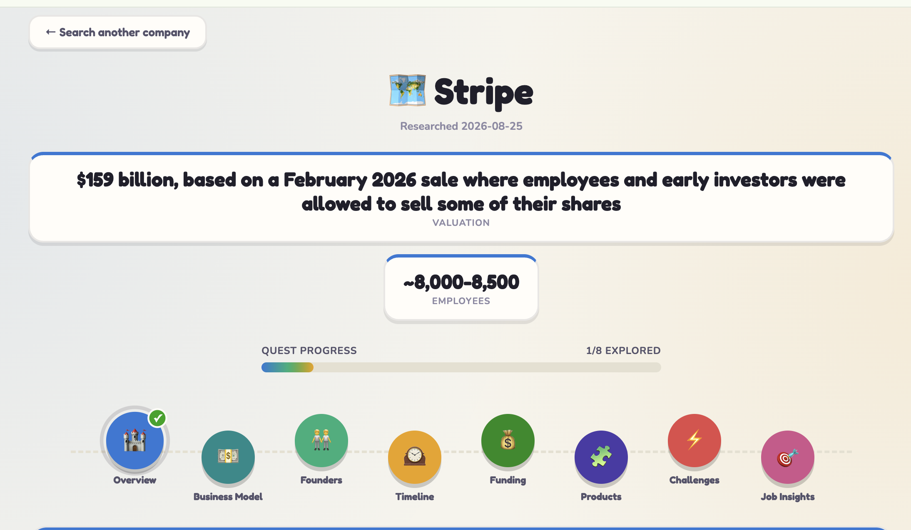

# 🧭 Company Quest

**Know the company before you interview.**

Company Quest is a zero-backend research viewer for job-interview prep — it turns scattered facts about a company (founders, funding, timeline, products, challenges, job insights) into one clean, easy-to-read dashboard.

## ✨ What it does

Overview: what the company does, who runs it, and its stated vision
Business model: how it actually makes money, broken into revenue streams
Founders: backgrounds and the story behind the company
Timeline: the milestones that matter
Funding: rounds, investors, and valuation where verifiable
Products: what they ship and who they compete with
Challenges: risks and controversies worth knowing before you walk in
Job insights: culture signals pulled from employee review sites

Every fact is tagged `verified` (2+ independent sources agree) or `reported` (single-source, use with caution) — so you know exactly how much to trust what you're reading.

### Example



## 🔍 Researching a new company

Company data is generated by a Claude Code slash command that cross-checks primary sources (official sites, filings, press) against independent journalism before writing anything down:

```
/research-company Anthropic
```

This researches the company, verifies every fact against multiple independent sources, adds the entry, and it shows up as an explorable chip on the landing page.

**House rules the research command follows:**
- No Wikipedia, no unauthored SEO listicles, no competitor-blog hit pieces
- Conflicting sources get flagged
- Every field is written in plain English — no unexplained jargon

**Where it looks:**

| Category | Sources |
|---|---|
| 🏛️ Primary | Company's own site (About / Press / Newsroom), SEC & regulatory filings, official press releases, founders' own interviews/talks |
| 📰 Independent journalism | Reuters, Bloomberg, TechCrunch, The Information, trade press (last 12–18 months preferred) |
| 📊 Data providers | Crunchbase, PitchBook, Tracxn — for cross-checking funding figures, never as the sole citation |
| 💼 Professional | LinkedIn company & founder pages |
| 🗣️ Culture / jobs | Glassdoor, AmbitionBox, Blind, and the company's actual open job listings |

## 🗂️ Project structure

```
company-map/
├── index.html           # the entire app — React (via CDN) + vanilla CSS, no build step
├── data/
│   ├── manifest.json     # index of researched companies
│   └── <slug>.json       # one file per company, matching a fixed schema
└── .claude/
    └── commands/
        └── research-company.md   # the research → verify → write workflow
```

## 🛠️ Tech stack

- **React 18** + **Babel** — loaded straight from a CDN, compiled in-browser
- **Vanilla CSS** — no framework, no Tailwind
- **Plain JSON** — the entire "database" is files on disk

That's it. No servers to manage, no API keys, no dependencies to update.
